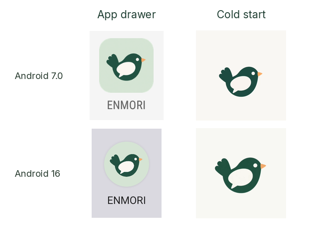

# Android 1.0.0 与 Azure v91 验证记录

当前交付为 Android 1.0.0 构建 92。[查看小鸟图标、启动画面与覆盖升级记录](#android-100-构建-92)

## Android 1.0.0 构建 90 与 Azure v91

2026 年 11 月 18 日。Android 安装包的显示版本为 `1.0.0`，构建号为 `90`，包名为 `com.enmori.app.group`。发布签名与 v88 一致。APK 有 70,838,156 字节，SHA-256 为 `d1d04ddbe2c8861f662d795648578dcb1c034002fa33c268dc26f23ef5e5a6e0`。

## 改动与复现

| 原来的表现 | 修复后的检查 |
| --- | --- |
| 老账号仅打开资料就可能出现未保存提示，改昵称时可能清除隐藏的旧地区。 | 覆盖了直接返回、修改昵称、修改简介和单位、显式清空地区以及两次并发修改。省略地区字段时，由服务端在核对资料版本的同一笔事务内保留当前值。 |
| 小屏横向、键盘展开、系统字体两倍时，输入框被底部按钮挡住。平板上的保存按钮横跨屏幕。 | 在 720 × 360 的 Android 模拟器上弹出系统键盘，确认可以看到输入框和顶栏保存按钮。在 1024 × 768 的平板布局下，表单和保存按钮的左右边界均为 236 和 844。 |
| 跨页搜索进行中清空输入，旧响应可能继续发起分页并显示旧结果。 | 模拟延迟响应后清空搜索，确认现有列表保留，旧请求完成后不会替换列表或继续翻页。单一搜索条件只显示一个清除入口。 |

后端只在更新请求中允许省略 `details.region`。显式传入 `null` 仍会清空，返回的资料保留完整结构。[本次决定](../../decisions/2026-11-18-li-profile-save-release.md)

## 自动化与产物

- Flutter 全量 2,029 项通过，静态分析通过。
- 后端全量 2,111 项、Azure 入口 9 项均通过。Firebase 主套件 243 项通过，另外 5 项按原设计在单独的模拟器项目执行，全部通过。Dart 客户端使用固定的 Dart 3.13.2 连接隔离的 HTTP、Auth 和 Firestore。
- 较早的一次模拟器回归中，两笔竞争启动事务均未取得运行时所有权。最终整套回归通过，相同竞争用例另在隔离项目连续通过三次。这些测试覆盖受控竞争，历史启动异常的原因仍待查证。
- 在 Android 模拟器的同一应用上由 v88 覆盖安装 v90。已安装 `base.apk` 与交付 APK 的 SHA-256 完全相同，冷启动后保留原有测试账号登录状态。没有卸载或清除应用数据。
- 生产源码提交为 `32ef00f65cbd4686ef952c65549a399734fd02d4`。Azure 包逐项对比已部署的 v89，共 8,570 个条目，7,619 个依赖条目一致。v91 ZIP SHA-256 为 `79430402d53e20d9111adcc6046b0ff22975f023ae9a70e16f07c88827f21a2b`。

## 线上结果

- 新加坡时间 09:34:09 提交停服，确认旧实例已停止后切换软件包，09:35:17 提交启动。09:39:19 首次从受保护接口收到预期的身份验证响应。由启动到该响应约 4 分 2 秒，由停服请求到该响应约 5 分 10 秒。实际应用容器内的 manifest 显示 v91 和上述源码提交，SHA-256 为 `3a78b70cf487deb1dce5e6c75515451fdb2e69ce5fff3e013550bef34d6057fb`。
- 同样一份省略地区且资料版本过期的请求，原 v89 返回 400。v91 按版本冲突返回 412。随后在专用验收账号用当前版本、相同资料内容提交一次，服务端返回 200。独立重新读取后，资料版本恰好增加一，地区及其他资料逐项一致，设置和首次使用状态也与保存前一致。针对非空旧坐标的保留和显式清空另由合成数据测试覆盖。
- 配置哈希与 v89 一致。停服前、停服后和新进程续租后的只读核对确认了运行时所有权和配额恢复。新旧账本的已花费、预留金额及尝试记录均一致。本轮验收使用测试模型或普通读写，没有调用付费模型。
- 重启后首次完整活动接口检查出现连接超时，当时的记录无法定位到具体来源。随后用相同验收账号重读，活动目录在 2.56 秒内返回 25 条。Ticketmaster 和 onePA 各取一条详情，均返回 200 且与目录中的活动 ID 一致。模拟器第一次打开资料编辑时出现加载失败，使用「Reload」后表单可正常打开。
- 横屏键盘和平板边界的对照使用 v88 和 v90 客户端，后端当时运行 v89。切到 v91 后，又在同一台模拟器上从已登录首页进入资料、打开编辑页并直接返回，随后打开活动浏览及筛选。在实际搜索框输入并清除查询，观察到单一清除入口，清除后该入口消失。两轮独立断网冷启动都显示重试，断网时再次重试保持可恢复，恢复网络后回到已登录首页。

## 稳定性范围

这份 APK 可用于本次 Android 交付。当前组合的设备验收来自 Android 模拟器，尚缺本版实体手机、TalkBack 和长时间运行记录。活动来源的长期可用性及历史冷启动异常仍待观察。正式条款原文仍待项目方提供。[上一轮稳定性记录](../2026-11-17-v87-deployment/README.md) [v89 与 onePA 优先级决定](../../decisions/2026-11-18-li-onepa-priority-and-ai-continuation.md)

## Android 1.0.0 构建 92

LI 选定「林间信使」后，桌面图标和原生启动画面都改用同一只小鸟。构建 92 延续 1.0.0 的显示版本。安装包有 71,005,936 字节，SHA-256 为 `b55693cad40716290a42dabcad67293c70c541e2b7b1a61bcbc3efcaf0b75168`。[图标决定与原图](../../decisions/2026-11-18-li-android-bird-icon.md)

| 模拟器 | 实际观察 |
| --- | --- |
| Android 7.0（API 24） | 全新安装后，在系统应用抽屉看到鼠尾草绿底的小鸟。冷启动录屏中，小鸟完整显示在米白色背景上，随后进入注册页。 |
| Android 16（API 36） | 在系统启动器中确认了圆形小鸟图标。浅色和深色模式的冷启动录屏都显示小鸟，注册页可正常打开。首次浅色录屏中系统启动等待超时，录屏已出现小鸟。重新冷启动后系统返回成功，并读取到注册页。 |
| 从构建 90 覆盖升级 | 在 Android 16 上用相同包名和签名安装构建 92。系统记录的应用 UID、初装时间和预设的 `en-AU` 应用语言均保留，安装后的 APK 校验值与交付文件一致。 |

本次构建的 Flutter 静态分析通过，完整测试套件共 2,029 项通过。

下图取自两台模拟器的系统应用抽屉和冷启动录屏，均已裁切。

