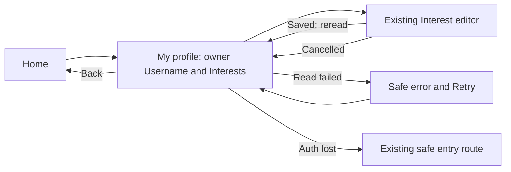

# LI first usable Profile slice — approval preview

**Status: Approved for bounded implementation on 2026-09-30.** Originally Proposed / Pending LI approval; LI's explicit confirmation is retained in [S-PM-0930-OWN-PROFILE-01](../decisions/2026-09-30-own-profile-first-slice-approval.md). Owner LI, different reviewer DU, parent [#44](https://github.com/3427564237/enmori-app/issues/44), kickoff [#45](https://github.com/3427564237/enmori-app/issues/45). Approval does not establish implementation completion or independent review.

## Proposed result

An authenticated, onboarded ordinary member opens **My profile** from Home, sees their canonical Username and their own saved Interests, opens the existing Interest editor, and returns to the profile and Home safely. This is a usable initial part of `own-profile`, not completion of Profile editing or Settings.

LI's supplied Profile screenshots also show account presentation/editing, Footprint, history/calendar, privacy/consent settings, an AI entry and logout. These remain traceable later feature/contract work; omitting them from this first slice is sequencing, not a decision to remove them. The existing history naming decision uses Footprint rather than a duplicate Check-in Timeline feature. LI's [functional-coverage clarification](../decisions/2026-09-30-sprint3-practical-delivery.md) permits justified layout/navigation simplification but identifies no specific feature for cancellation.

Use the existing architecture and read/write contracts. No Backend/API/Firestore/dependency change is proposed. Approval is needed for this exact minimal surface and navigation/content contract because Q04-D accepts the route inventory, not every Profile field/action.

## Source and field boundary

Sources: [Q04-D](../superpowers/specs/2026-09-02-q04-d-inventory-content-acceptance-draft.md), [RMVP-01A R2 approval](../decisions/2026-09-03-rmvp-01a-contract-approval.md), [S2 own-interest contract](../planning/2026-09-14-s2-interest-data-mapping.md), [Q18 immutable Username](../decisions/2026-09-02-add-friend-identity-matching-contract.md), and [Q16 independence](../decisions/2026-09-02-recommendation-empty-result-contract.md).

| Existing value | Type and purpose in this proposed surface |
|---|---|
| `Account.username` | Canonical immutable String; display to its authenticated owner only |
| `OwnInterests.interestTags` | 0–10 saved entries; display `displayName` and inactive state; retain Backend order |
| `interestTagId`, `revision` | Existing typed repository/editor data; not user-facing identifiers or a new purpose |

Username is never editable or reused. No Date of Birth, age, Region, School/Community Context, Bio, avatar or new DisplayName field is collected/displayed. `checkInVisibility` is not Profile Privacy and must not be used as its substitute. This surface makes no other-user disclosure claim. Existing optional-processing consent is not relabelled as a guarantee that every AI operation is enabled.

Profile field editing, Profile Privacy, consent mutations, verification/recovery, new consumer projections and their physical contracts remain separate Pending work. They do not block this proposed bounded page once approved.

## Existing payloads, unchanged

`GET /v1/me/onboarding` uses the current authenticated owner's existing gate/Account projection. Onboarding-completed HTTP 200:

```json
{"status":"completed","account":{"username":"member_a","optionalProcessingConsent":"accepted","checkInVisibility":"public","onboardingCompletedAt":"2026-09-30T00:00:00.000Z"}}
```

Only Username is displayed here. Existing 401/403/503 and incomplete-onboarding outcomes keep their existing gate semantics. Do not invent a Profile endpoint or make another user's Account request.

`GET /v1/me/interests`, HTTP 200:

```json
{"interests":{"interestTags":[{"interestTagId":"music","displayName":"Music","lifecycleState":"active"}],"revision":1}}
```

Empty success remains valid:

```json
{"interests":{"interestTags":[],"revision":0}}
```

The existing editor retains `GET /v1/interest-tags` and `PUT /v1/me/interests` with `interestTagIds` and `expectedRevision`. HTTP/error/concurrency and inactive-Tag rules remain exactly as approved; no new query, mutation or storage is selected.

## Use case and proposed page behavior

**Data:** existing authenticated subject/gate, owner Account Username, saved Interest projection, and existing editor result. No client-selected Account ID.

**Primary:** Home pushes proposed `/profile`; use the current owner-scoped onboarding provider for immutable Username and read the existing own Interests on page entry. Display `My profile`, `Username`, `Interests`, and `Edit interests`. The existing editor is pushed above the profile. After successful save, read own Interests again and ensure Home's recommendation computation is refreshed through its existing approved request-independent behavior when returning. AppBar and system Back pop to Home.

**Empty:** show `No interests selected.` and keep Edit interests available. Inactive saved Tags remain visible using the existing inactive label; they are not silently replaced or newly assigned.

**Error/offline:** no offline cache is added. On interest-read failure, show `Interests could not be loaded. Try again.` with `Retry`, preserving safe existing failure mapping. Do not display raw vendor errors or manufacture interests. Existing Account/Auth gate failure takes the user to its approved safe route.

**Cancel/race:** backing out of an unsaved editor creates no saved change. Leaving the profile, replacing the authenticated subject, or losing the auth gate prevents an old Interest result or return callback from updating another page/account. Retry creates a new read; only the latest current operation may update this page. Successful save updates are distinct from cancelled navigation. No new automatic retry/timeout policy is introduced.

## Acceptance and review boundary

1. Given an authenticated onboarded owner, opening My profile shows only that owner's existing Username and saved Interests.
2. Given zero saved Interests, the empty state is successful and the existing editor can save zero or valid selections.
3. Given active/inactive saved Tags, their approved semantics are preserved; invalid/stale mutations still use the current editor contract.
4. Given a successful edit, the profile reflects a later own-interest read and Home recomputes under Q16; cancellation leaves saved state unchanged.
5. Given Back, late read, changed account or lost auth, navigation/state remains safe with no cross-account or disposed-page update.
6. Given a read failure, safe error and explicit retry work; no private content or raw errors are exposed.

Owner widget/repository-boundary tests and static checks cover these cases; integrate against the unchanged real Backend where the approved evidence gate requires it. DU reviews the bounded implementation and its combined evidence packet once ready. This approval preview does not ask DU to approve product authority or each preparatory paragraph, and it does not claim visual fidelity, full M28/M29 coverage, device Pass or Done.

This reuses existing typed models, so no new model or app architecture diagram is warranted. It preserves the current app dependency graph. Minimal flow:


