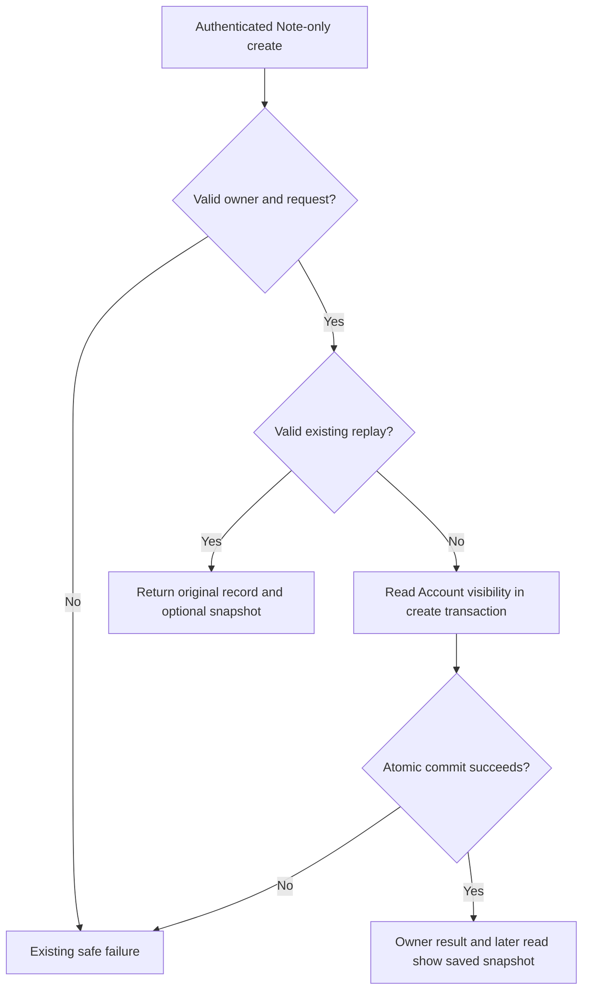
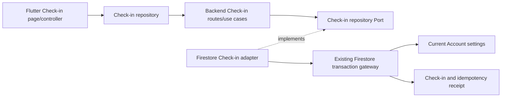

# LI blocker resolution preview — Check-in, Friend and Event

**Status: Proposed; awaiting LI confirmation.** Prepared 5 October 2026. This is a reviewable proposal, not a PM decision or implementation authorization. No proposal below may be promoted to an approved requirement without the corresponding confirmed decision under `docs/decisions/`.

## Verified boundary

- PR #50 remains Draft/Open at `497dc1661105f8212f7a0987655ff48aa1a7627e`. [DU's current-head Changes Requested review](https://github.com/3427564237/enmori-app/pull/50#pullrequestreview-5411188002) identifies an inert Check-in default and a contract conflict. Historical approvals do not cover the current head.
- Friend preparation PR #52 at `c31bb35057c0ad7596758cd43057c326b9fa47d7` was independently approved, merged and accepted; #46 is closed for preparation. The [accepted proposal](https://github.com/3427564237/enmori-app/blob/c31bb35057c0ad7596758cd43057c326b9fa47d7/docs/planning/2026-10-02-s3-jin-friend-contract-proposal.md) still leaves physical contracts and authoritative producer inputs Pending.
- Event preparation PR #51 at `742a14e81e41916cd469058e41ee4359952abfc1` was independently approved, merged and accepted; #47 is closed for preparation. The [accepted proposal](https://github.com/3427564237/enmori-app/blob/742a14e81e41916cd469058e41ee4359952abfc1/docs/planning/2026-10-01-s3-event-detail-contract-proposal.md) still leaves E01–E07 Pending.
- Remote main was refreshed to `281c16b07a64633dea083808f9b8a3a567d7e6c4`. Preparation acceptance does not establish implemented Friend/Event behavior.

## C01 — Make the Check-in default effective, or explicitly defer it

### Controlling sources and conflict

Retain [S-PM-0903-RMVP01A-CONTRACT](../decisions/2026-09-03-rmvp-01a-contract-approval.md) and its [approved R2 specification](../superpowers/specs/2026-09-03-rmvp-01a-refinement-contract-r2-preview.md), including the three-field persisted Check-in, Note-only input, owner-only access and deferred social-read rules. Retain [S-PM-1005-LI-PROFILE-SETTINGS](../decisions/2026-10-05-li-profile-settings-approval.md) and its [approved preview](2026-10-05-li-profile-settings-contract-preview.md), which says the saved default applies to later Check-ins while leaving existing Note persistence unchanged.

The implementation saves `accounts/{accountId}.checkInVisibility`; the create transaction reads the Account but neither consumes nor persists this value. Settings persistence and reread tests therefore do not establish future Check-in behavior. The previous Android scenario did not create a Check-in after changing Settings. Its historical results remain valid only for the exercised flows.

### Recommended choice A — creation-time metadata

As an onboarded authenticated member, I want a new Check-in to retain the visibility selected in Settings at creation, so later Settings changes do not silently change that Check-in's recorded choice.

Approval would make this **explicit narrow amendment**, rather than interpreting the existing three-field constraint as permission:

| Property / boundary | Proposed contract |
| --- | --- |
| New persisted property | `checkInVisibility`: `private`, `friends_only` or `public`; required for newly created records after this amendment |
| Authority | The current owning Account, read inside the existing Check-in creation transaction; no client-supplied visibility or owner |
| Existing persisted fields | `ownerAccountId`, `note`, `createdAt` retain their meanings |
| Public own projection | Existing `checkInId`, `note`, `createdAt`, plus optional `checkInVisibility`; optional only for legacy records |
| Legacy records | No backfill, inferred visibility, on-read update or migration |
| Replays | Return the first committed Check-in, including its original visibility; the existing Note-only fingerprint and 24-hour receipt rules remain |
| Later Settings edits | Affect subsequent new creations only |
| Reading by others | Not authorized; all three choices remain metadata in the existing owner-only surface until a separate social-read contract is approved |
| UI | Show the canonical saved value in the owner's save result and later read; never label a legacy record with a fabricated choice |
| Other behavior | No new endpoint, content type, Mood/Weather/Activity/location field, dependency, collection, index or deployment |

“Note-only” continues to constrain user-authored content. Approval explicitly supersedes only the old record-field restriction to permit this one server-derived metadata field. It does not supersede owner-only access or the deferred third-party visibility interpretation.

### Use case — create and read

**Data:** verified Backend principal; valid Note; existing Idempotency-Key; current AuthBinding and Account; existing server time and opaque Check-in identity; optional existing receipt/Check-in for replay. The client supplies only Note and the existing command header.

**Primary:** validate the existing request; resolve and read the owner inside the existing protected boundary; replay the original result when applicable; otherwise copy the Account visibility into the new record and commit it with the receipt atomically; return the persisted projection; show its canonical visibility. A later owner read returns that same snapshot.

**Errors:** keep existing authentication, onboarding, validation, conflict, ownership and dependency failures. An invalid current Account prevents a new save. A present but invalid stored visibility fails closed instead of becoming a synthetic default. A failed transaction is not a saved result. Unsupported extra request properties, including visibility, remain rejected.

**Cancel:** leaving the composer before submission does not write. Navigation or account replacement after submission discards late UI results; it does not assert that an in-flight Backend commit was rolled back. Existing replay/recovery semantics remain.

### Payload examples

`POST /v1/check-ins`, existing authentication and Idempotency-Key. Request unchanged:

```json
{"note":"A quiet walk."}
```

New creation: HTTP `201`; successful same-key replay: HTTP `200`, with the same Check-in and snapshot:

```json
{"checkIn":{"checkInId":"synthetic-checkin-1","note":"A quiet walk.","createdAt":"2026-10-05T08:00:00.000Z","checkInVisibility":"friends_only"}}
```

`GET /v1/check-ins/{checkInId}`, HTTP `200` for an authorized own record. A legacy response demonstrates omission, rather than a fabricated default:

```json
{"checkIn":{"checkInId":"synthetic-legacy-1","note":"Earlier note.","createdAt":"2026-09-05T08:00:00.000Z"}}
```

Existing failure envelope and HTTP mappings remain. There is no new other-user read route.

### Acceptance and verification

All new amendment checks are **planned, Not Run**:

1. Given each of the three saved Settings values, when a new Check-in commits, then the response, persisted record and later owner read contain that value.
2. Given a committed Check-in, when Settings changes, then reading or replaying that Check-in preserves its first value; a genuinely new creation uses the new value.
3. Given Settings and create operations that overlap, when their protected transactions commit, then the Check-in reflects a consistent Account value from its successful transaction, never an unchecked client preview.
4. Given legacy or malformed stored data, when read/replay occurs, then absence remains absent and invalid present metadata fails closed; no record is changed during a read.
5. Given an unauthorized account or a client-supplied visibility field, when read/create is attempted, then existing ownership and strict-request protections apply.
6. Given the real Android app and isolated synthetic Auth/Firestore Emulators with the Backend handler, when Settings is saved and an actual Check-in is created and reopened, then the visible canonical value follows the persisted record. This replaces the missing consumer-chain verification; the earlier Settings-only test is not promoted to this result.



Existing dependency graph, with proposed data propagation along the existing path; arrows mean “depends on”:



### Alternative choice B — explicit deferral

Keep the three-field Check-in record and existing API. Remove or disable the misleading future-Check-in selector in Settings and state the current owner-only read boundary. Persist a PM decision that explicitly defers the saved preference's effect, and amend the product claim and verification packet. Previously saved Account values need not be erased. This is an alternative to A; neither is approved yet.

### Completion path after C01 confirmation

Persist the chosen amendment; implement only it; update OpenAPI/Backend/Flutter as warranted; execute the missing consumer-chain checks; prepare one focused DU review packet. Publication requires the user's existing action-time confirmation rule. DU must review the new exact head; local success does not discharge Changes Requested, merge predecessors, close #45 or complete Sprint 3.

## F01 — Friend scope and missing authority

The [Q18 contract](../decisions/2026-09-02-add-friend-identity-matching-contract.md) already authorizes exact Username lookup, protected request transitions and minimum target presentation. It does not authorize a physical lifecycle/block schema. Onboarding completion alone does not establish all required eligibility gates.

Recommended next scope for LI review: exact lookup, send, recipient current-request read, accept/decline and a fresh relationship read, independent of recommendations, Event associations and Activity. Before public APIs are released, prepare one concrete contract covering:

- the authoritative Account eligibility source, either-direction block source and shared protected transition boundary;
- exact method/path/DTO/error mapping, current DisplayName presentation including the existing optional-name case, bounded recipient reads and a distinct opaque action reference per request;
- pair uniqueness, 30-day expiry and stale-reference rejection; no terminal-history product or unapproved retry retention;
- operational lookup/send protection and uniform protected results.

No missing block record is silently equated with an approved “not blocked” decision. No lifecycle field, initial state, existing-account migration, threshold or new disclosure is selected by this preview. LI is being asked whether to commission and approve this smallest complete contract next, or keep public Friend APIs deferred and allow only already-authorized component work. A positive scope answer does not by itself approve unspecified physical choices.

Owner remains JIN; independent reviewer remains SHI. LI owns the missing producer/PM decisions. This preview does not implement or reassign the Friend module.

## E01 — Event implementation versus provider access

Recommended next scope: Detail with its existing proposed minimum fields, owner participation separated, unchanged six-field recommendation records and unchanged Home/See All eligibility. A synthetic contract implementation can be reviewed independently; it cannot prove real provider coverage or permission.

Before final implementation approval, specify Detail limits/error and missing-value copy, EventId occurrence binding, a separate source/detail projection, freshness/removal rules and outbound-link policy. Missing-end browsing and participation remain separate decisions; do not add them implicitly to the first Detail slice.

The user is being asked whether authorized Ticketmaster API access and the applicable display/storage/link basis already exist. Ask only for non-sensitive authorization references; never request an API key in chat. If absent, actual acquisition/import remains blocked while a specifically approved synthetic Detail slice can proceed. If present, inspect the applicable basis and a sanitized Singapore API sample before choosing live acquisition/storage and exact mapping rows.

The [source research](https://github.com/3427564237/enmori-app/blob/742a14e81e41916cd469058e41ee4359952abfc1/docs/evidence/sprint3/2026-10-01-shi-event-source-research.md) contains one proposed **website** `Concerts` → `interest_music` row. It is not an API taxonomy observation or approved mapping. This preview activates no mapping and grants no provider rights.

Owner remains SHI; independent reviewer remains ZHOU. Provider rights cannot be supplied by an internal PM approval alone. No real source result, implementation Ready status, Android Pass or module completion is claimed.
