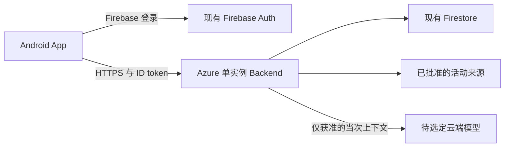

# 云端部署：可执行选择与迁移差异

28 October 2026 (SGT)。状态：**方案已核对，尚未选定或部署**。
依据：[LI 确认的云端目标](../decisions/2026-10-28-li-cloud-service-objective.md)。
目的：别人安装 App 后，LI 的电脑关机也能使用 Backend 和 AI。

## 推荐路线

第一阶段采用 **Azure 上单实例 Linux Backend + 独立云端推理**，保留现有
Firebase Auth / Firestore。优先核验 Azure for Students 的可用 x86 VM、区域、
额度和总报价，再选择实例。当前服务有进程内执行状态、退出等待和文件锁，
单实例 VM 比立即改成弹性容器少一层生命周期改造。此为工程建议，尚非选定架构。

Ollama Cloud 可作为推理候选，但不应作为“免费且直接兼容”的已定方案。
先用固定合成语料验证一个具体云模型，再决定是否接真实数据。当前公开模型目录
包含 `gemma4:31b`、`gpt-oss:20b` 等，未列出当前本地的 `qwen3.5:9b`。
建议首个候选采用官方云端示例的 `gemma4:31b`；这不代表质量通过，也不授权调用。

上述链路不经过 LI 的个人电脑；云端模型密钥只放在 Backend。

## 免费范围已核实

| 选择 | 官方条款及实际限制 | 本项目判断 |
| --- | --- | --- |
| Azure for Students | 100 美元、12 个月，符合资格时可续；部分服务有免费数量，新客户的部分额度仅首年适用；无需信用卡注册 | 可以用学生额度承担试运行，但不是所有资源永久免费。学生身份、余额、SKU/区域配额尚未登录核验 |
| Azure 单实例 VM | 学生页列出 B1s / B2pts v2 / B2ats v2 的限定免费时数；Arm 与现有 x86 工具包不能混用 | 对实际订阅逐项核验 VM、磁盘、公网 IP、流量、备份及日志。不能只看计算时数就承诺零费用；不选 GPU、不在小型免费 CPU 上承诺 9B 模型性能 |
| Azure Container Apps | 每月前 180,000 vCPU 秒、360,000 GiB 秒及 200 万请求免费；常驻最小副本仍有资源计量 | 备选。需要解决进程退出、文件状态及部署副本重叠；不能为了免费直接设自动归零或多个副本 |
| Ollama Cloud | 当前直接打开的价格页为 Pay as you go，零订阅费但每次请求消耗 token 额度；Pro/Max 属于付费方案 | 没有核实到学生无限免费权益。搜索缓存仍有旧 Free/starter 描述，不能拿它覆盖当前页面或用户实际账户条款 |

Azure 的学生额度不能用来支付独立 Ollama 或 Firebase 的账单；Microsoft 明确排除
Marketplace / 单独许可的第三方产品。额度耗尽或到期会停用服务，除非用户主动升级；
不自动升级付费、不移除支出限制。预算提醒也不能当作逐笔硬性限额。

费用示例仅为算术：按当前 Gemma 4 每百万输入 $0.14、输出 $0.40，
1,000 次各 3,000 输入和 512 输出 token 约 **$0.6248**；不含额外计费 token、
Azure、Firebase、流量或税，不是账单或上限。若要求一分钱都不花，必须先确认
账户赠送额度或另选确有可用免费额度的服务；当前不能承诺 Ollama 路线满足它。

Container Apps 数量示例：0.25 vCPU / 0.5 GiB 连续分配 30 天分别为
648,000 vCPU 秒和 1,296,000 GiB 秒，均高于列出的免费数量。活跃/空闲费率不同，
官网价格表未返回本地区的货币单价，因此没有编造月费。

## 代码核对出的迁移差异

| 位置 | 当前行为 | 上云时必须完成的具体改动 |
| --- | --- | --- |
| `tool/run_real_account_local.mjs` | 本机配置、私有证书、9381/9382 回环监听、文件所有权锁、readiness 校验 | 云主机独立配置与服务用户；公有 HTTPS 入口；只让受控代理访问内部监听；凭证通过私有服务器配置交付，禁止复制整个个人状态目录 |
| `backend/src/bootstrap/retained-core-runtime.ts` | 显式构造 `LocalModelLane`；启动与发送前预加载；Chat/Persona/first-flow 共用 lane；退出等非终态结束 | 单实例组合接入经批准的云 transport；保留操作所有权、原响应结算和未知结果隔离；不能把退出超时当成请求未执行 |
| `backend/src/ai-runtime/infrastructure/local-model-lane.ts` | `127.0.0.1:11434`、`/api/ps`、空 prompt preload、固定 schema、8192/512、120 秒物理接收 | 云 API 不调用本机驻留检查、不发空预加载；验证实际终态/模型/响应体；不自动重试、fallback 或清除未知结果；模型的 thinking 和输出限额须实测，不能机械复制本地参数 |
| `lib/app/bootstrap.dart` | remote mode 只允许现有 Tailscale 主机与 8443 | 新域名确定后增加明确部署配置及拒绝错误主机/混用 emulator 的测试；不能简单放开任意 HTTPS URL |
| `ai_selected_reply_review.dart` / `ai_conversation_page.dart` 与批准的上下文合同 | 现有说明写明本地处理 | 确定处理商/区域/用途后形成明确同意变更并在客户端及服务端共同执行；旧本地同意不能默认为新处理商授权 |
| `tool/retained_core_events.mjs` 与当前来源配置 | 有运行目录、受控 provider 配置及有界内存投影 | 迁移所需服务器配置，验证真实目录/推荐；不夹带新来源、抓取 worker 或虚构缺失字段 |

Ollama 官方明确：**Cloud 当前不支持 structured outputs**。因此现有 `format`
JSON schema 不能直接照搬。候选适配方案是在合成验证中要求 JSON、继续使用严格
schema 校验，格式无效即失败，不增设修复调用；其稳定性必须计入真实评测。
另一种“Backend 将纯文本包装为内部消息”的协议改动需单独明确，不能暗中代替
模型输出校验。若质量/结构不通过，应选择支持所需约束的云服务，而非降低现有校验。

官方当前说明云请求主要在美国处理，也可能路由欧洲；不能宣称固定在新加坡。
无训练/零日志的服务说明不等于数据未离开本地。只发送该次获准上下文，不迁移整库
给模型，不上传历史原始测试日志，不把模型 key 或 Firebase Admin 放入 APK。

## 执行顺序与可验证完成条件

1. 核验用户已开通的学生订阅：余额/到期日、支出限制、可用区域、实例及包含磁盘/IP
   的实际报价。未获取账户权限前只做公开资料和源码核对。
2. 确认单实例 Backend 与实际 HTTPS 域名、云模型、数据处理范围和额度。先做最多
   一轮固定 24 条纯合成测试，最多 24 次串行生成，不重试未知结果；费用必须有
   账户层上限与服务端预算支持。这个测试额度是待选方案，尚未获得新提供商执行授权。
3. 在独立云环境完成 adapter、配置、同意与启动边界的源测试。复用现有 Firebase
   数据模型和原始签名；不创建第二套业务数据，也不开放自动扩容。
4. 部署一个版本，确认身份验证、双账号隔离、记录保存/读取、活动来源和真实 AI
   回复；断网/取消/重启时验证原未知操作不会重发。Azure 只读 readiness 不能代填
   模型和业务验收。必要的合成账户须先按既有授权隔离。
5. 生成同签名递增版本 APK，手机移动数据测试；断开个人主机到云端的一切依赖后
   验证相同业务。用户实际关闭个人主机时由手机验证，记录前后端点与结果。当前
   v41 仍是本机服务候选，不是云端版本。
6. 保留旧 APK/服务候选；出现未知执行时只停接新流量并核对原操作，不以切回旧服务
   自动重发请求。云端日志仅保留必要运维信息，不记录 token、正文或上下文。

## 当前尚需的选择

建议：**先开通/核验 Azure for Students；确认单实例 VM 方案的实际免费额度。
Ollama 仅在账户确有可用赠送额度或用户明确允许小额费用后作合成候选。**
若坚持长期零自费，现有公开资料不足以选定一个同时满足持续可用和 AI 推理的方案。
这不阻止现有客户端修复、安装包、语义核验及回归交付。

本次没有登录云账户、创建资源、购买额度、改公网地址、部署云服务或发送云推理请求。

## 官方核对来源

以下均于 2026-10-28 直接读取；实际账户权益仍待核验。

- [Azure for Students](https://azure.microsoft.com/en-us/free/students/)
- [学生订阅 FAQ 与用途](https://learn.microsoft.com/en-us/azure/education-hub/faq)
- [学生优惠条款与第三方排除](https://azure.microsoft.com/en-us/pricing/offers/ms-azr-0170p)
- [额度耗尽后的停用](https://learn.microsoft.com/en-us/azure/cost-management-billing/manage/azurestudents-subscription-disabled)
- [Container Apps 资源计量](https://azure.microsoft.com/en-us/pricing/details/container-apps/)
- [Ollama 当前价格](https://ollama.com/pricing)
- [Ollama Cloud API](https://docs.ollama.com/cloud) 与 [公开模型目录](https://ollama.com/api/tags)
- [Cloud structured outputs 限制](https://docs.ollama.com/capabilities/structured-outputs)
- [thinking 参数因模型不同](https://docs.ollama.com/capabilities/thinking)
