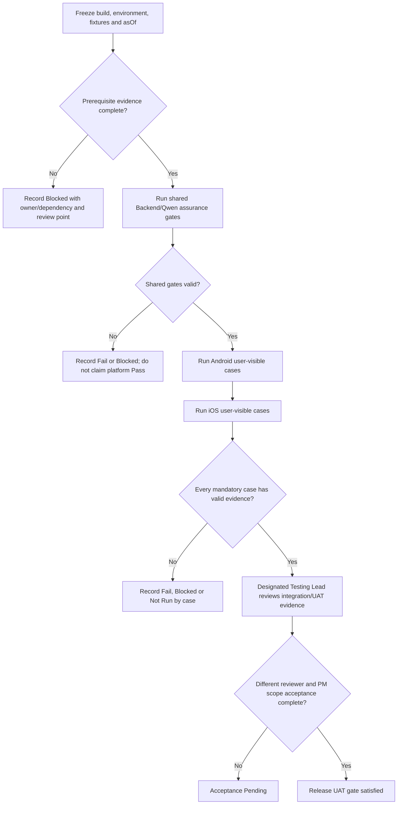

# COMP3851B Week 9 Release MVP UAT baseline

- **Status:** Approved verification baseline by LI HOURUI on 2026-09-02; every case remains `Not Run`
- **Baseline ID:** UAT-B-0902-R1
- **Release authority:** [S-PM-0901-SCOPE](../decisions/2026-09-01-comp3851b-mvp-scope-priorities.md)
- **Governance:** [S-PM-0902-GOV](../decisions/2026-09-02-project-authority-supersession-governance.md)
- **Historical boundary:** This is a new COMP3851B baseline. It does not close Q-C9 or convert the COMP3851A 15/20 snapshot into 20/20.
- **Implementation status:** Not executed; no Pass, Release acceptance, or implementation readiness is claimed

The PM approved this verification baseline after correcting the Q18 Release-scope gate, CORE-16 authority gate, CORE-08/09 evidence classification, Q04 deviation-candidate references, and staffing wording. Approval accepts the verification contract only. It does not approve implementation, make any PBI Ready, add Q18 Add Friend/Friend Request to the Week 9 mandatory Release scope, resolve the CORE-16 disclosure contract, approve a retained Q04 deviation candidate, or record Release acceptance.

## 1. Purpose and user value

This baseline defines how the team will demonstrate that the Week 9 ENMORI Release MVP gives an ordinary community member a privacy-aware, runnable flow for account entry, profile/interests/privacy, Check-in, Event interaction, Calendar, Footprint, deterministic Recommendation, Persona management, and bounded AI assistance.

It is an acceptance contract and evidence template. It does not define endpoint names, DTO fields, Firestore collections, deployment product names, visual layout, or implementation mechanisms that remain outside the approved requirement boundary.

Artifact selection is deliberately limited to acceptance narratives, executable UAT cases, controlled data/fixture requirements, evidence rules, and the Release execution flow. Existing decision records already own the behavioral use cases, domain semantics, architecture and purpose-specific data boundaries. New Model Specs or HTTP payload contracts are omitted because adding them here would invent the still-deferred physical API/schema contract.

## 2. Confirmed execution boundary

The PM confirmed this execution boundary on 2026-09-02:

- UAT covers the Week 9 ordinary-community-member Release MVP: the approved core flow plus Must Event Recommendation, Friend Recommendation, Friends Activity ranking, Persona management, and bounded AI Assistant.
- Admin Recommendation Configuration and Account Action Request approval/execution are excluded. Q-28 and Q-27 remain separate affected-scope blockers.
- User-visible UAT runs on Android and iOS devices against the controlled HTTPS demonstration Backend, an isolated demonstration Firebase environment, and the approved Qwen 9B digest on the controlled host.
- Emulator Suite and Fake Qwen evidence are automated/integration prerequisites only; they cannot substitute for Android/iOS UAT or live controlled-host Qwen evidence.
- ENMORI has no approved custom offline product mode. Loss of connectivity is exercised only as an approved error, empty, unavailable, or fallback condition.
- Device models, OS versions, build identifiers, environment names, URLs, test-account identifiers, timestamps, and dependency controls are recorded at execution time rather than invented in this baseline.
- The UAT contract names execution roles, not fixed personnel. Sprint-specific owners, reviewers, UAT evidence owners, and device validators are assigned through the [approved ENMORI Sprint Planning policy](../../.agents/skills/enmori-scrum-planning/references/team-policy.md).

## 3. Scope exclusions

The following are not accepted or rejected by this baseline:

- Admin Recommendation Configuration, arbitrary factor registries, or new recommendation algorithms;
- Account Action Request approval, rejection, execution, notification, appeal, account mutation, or restoration;
- public long-term Internet deployment, automatic model routing/failover, end-user model selection, or custom offline synchronization;
- password-recovery and six-digit prototype-verification behavior not supported by an approved production contract;
- unfriend, Check-in edit, standalone AI Safety, Going-people directory, Persona templates, or Persona duplication where current authority retains prototype evidence only or explicit exclusion;
- pixel-accurate acceptance, unresolved Q04 deviations, shared-pattern acceptance, or missing Version 5 capture/provenance gates; and
- retrospective claims about COMP3851A completion or historical UAT repair.

## 4. Acceptance narratives

### Narrative N1 — connected ordinary community member

As an authenticated ordinary community member with connectivity,
I want to complete the approved ENMORI Release flow and receive privacy-filtered deterministic and bounded-AI results,
so I can record and review my activity context, discover Events and people, and receive assistance without surrendering authorization or ranking decisions to AI.

### Narrative N2 — member rejecting optional AI/data consent

As an ordinary community member who rejects optional AI/data consent,
I want to continue into ENMORI with the affected AI processing unavailable and unrelated deterministic/core behavior preserved,
so I can use the product without the rejected processing being performed.

### Narrative N3 — member encountering dependency failure

As an ordinary community member encountering network, Weather, Firebase, or Qwen failure,
I want ENMORI to fail safely and preserve every approved non-blocking or deterministic path,
so a dependency failure neither invents data nor silently changes authorization, privacy, Recommendation order, or persisted state.

### Narrative N4 — Release assessor

As the ENMORI test lead or PM Release assessor,
I want every claimed outcome tied to repeatable Android/iOS or controlled-host evidence,
so Release acceptance distinguishes observed Pass, observed Fail, environmental Blocked, and Not Run without ambiguous completion claims.

## 5. Result vocabulary and evidence rules

Only these execution results are permitted:

| Result | Meaning |
|---|---|
| `Not Run` | No valid execution evidence exists. This is the default. |
| `Pass` | Every step and expected result was observed in the required environment and the evidence record is complete. |
| `Fail` | The case ran in a valid environment and at least one expected result was not observed. |
| `Blocked` | The case could not validly run because a named dependency, decision, environment, fixture, build, or device gate was unavailable. |
| `Not Applicable` | A controlling authority explicitly makes the case inapplicable to that recorded platform/configuration. It is never a convenience substitute for `Not Run`. |

An evidence record contains:

- UAT ID, build commit and artifact identifier;
- Android or iOS platform, device model, OS version, and app identifier;
- execution timestamp with timezone, tester, environment identifier, and controlled Backend/Qwen identity where applicable;
- test-data fixture version and captured `asOf` when ordering or time windows matter;
- numbered step results, observed output, and relevant screenshot, recording, or sanitized log;
- actual result, defect/blocker reference, retest reference, and reviewer/acceptor; and
- confirmation that evidence contains no credential, token, private content, prohibited log field, or uncontrolled real-user data.

User-visible cases marked `Both` must independently Pass on Android and iOS. Android/Linux evidence cannot substitute for iOS evidence. Backend/operational cases marked `Shared + surface` require controlled-host evidence once plus the named Android/iOS visible outcome where applicable.

Cases explicitly marked `Release-scope gated; non-mandatory` or `Authority-gated; non-mandatory` are excluded from the mandatory Week 9 Pass set until the named authority gate is durably resolved. Their presence records the accepted future verification contract; it does not expand Release scope. They remain `Not Run` unless valid execution evidence is deliberately collected, and their absence cannot be converted into a mandatory Release failure.

## 6. Controlled fixture catalogue

Fixture identifiers are execution-local and must not become product defaults or schema decisions.

| Fixture | Required controlled state |
|---|---|
| F-ACCOUNT-A | Active ordinary Account; no Admin authority; known email/password; owned Profile, Interests, privacy and consent controls. |
| F-ACCOUNT-B | Active established friend of A with purpose-authorized and purpose-denied data variants. |
| F-ACCOUNT-C | Active eligible Friend Recommendation candidate; not A, not an existing friend, and no Pending request in either direction. |
| F-ACCOUNT-X | Ineligible/non-discoverable/protected candidate used to prove exclusion without exposing the reason publicly. |
| F-FRIEND-REQUEST-SET | Exact canonical Username, nonexistent/ineligible/blocked targets, no relationship, outgoing/incoming Pending, established Friendship, accepted/declined/expired/invalidated states, and race-controlled Account pairs under Q18. |
| F-EVENT-SET | Active/published and ineligible Event variants with fixed opaque IDs, Interest Tag references, start instants, Interested/Going state, external registration URL, and visibility variants. |
| F-CHECKIN-SET | Note-only, Mood-only, invalid-empty, Weather-enriched, Weather-unavailable, privacy variants, Approx Location variants, and fixed timestamps across selected dates. |
| F-ACTIVITY-SET | Authorized and filtered friend activity with fixed activity type, occurrence time, Special Care state, and deterministic tie data. |
| F-PERSONA-SET | Zero through five owner Personas using only approved structured fields, with inactive/active and deletion variants. |
| F-AI-CONTEXT | Eligible/ineligible Check-ins around the preceding-seven-day and maximum-five boundaries, consent variants, source-deletion races, and approved Persona projection variants. |
| F-DEPENDENCY-CONTROLS | Controlled Weather unavailable/invalid, Firebase unavailable/unauthorized, Qwen unavailable/timeout/invalid-output, and network-loss controls. Exact injection mechanism remains implementation evidence, not a requirement invented here. |

## 7. UAT cases

All cases are `Not Run` until execution evidence says otherwise.

### 7.1 Release environment and identity gates

| ID | Platform | Data / Given | When | Then | Primary authority |
|---|---|---|---|---|---|
| ENV-01 | Both | Release build from recorded commit | The assessor installs and launches it | Android application ID and iOS base bundle identifier are `com.enmori.app`; build and launch evidence is recorded | S-PM-0901; bootstrap/environment contracts |
| ENV-02 | Shared + surface | Controlled device, HTTPS edge, Backend and Ollama host | The device uses an authenticated product operation | Only the controlled HTTPS edge is device-visible; raw Backend and Ollama listeners are not used by the device | S-PM-0901-BACKEND |
| ENV-03 | Shared | Isolated demonstration environment and fixed fixtures | The suite is prepared or reset | Test actions cannot target uncontrolled real-user or separate demonstration data; environment identity and reset evidence are recorded | S-PM-0901-BACKEND |
| ENV-04 | Shared + surface | Loaded Qwen 9B Release candidate | AI readiness and one valid request are exercised | Expected model identity, exact digest, isolation and loaded-state evidence match Q31-A/E before AI cases proceed | S-PM-0902-Q31 |
| ENV-05 | Both | Complete case run | The tester submits evidence | Device, OS, command/build, timestamp, environment, fixture, result and useful artifact fields are present; missing fields prevent `Pass` | S-PM-0901-SCOPE; team iOS evidence rule |

### 7.2 Entry, Profile, privacy, Check-in, Event and history flow

| ID | Platform | Data / Given | When | Then | Primary authority |
|---|---|---|---|---|---|
| CORE-01 | Both | New ordinary member; valid email/password; no Account | The member signs up and accepts initial AI/data consent/privacy choices | Account entry completes and the member can continue to the approved ordinary flow | S-BR1/S-BR4/S-BR45; S-PM-0901-SCOPE |
| CORE-02 | Both | New ordinary member; valid email/password | The member rejects optional AI/data consent/privacy choice | Entry still continues; rejected processing is not performed; unrelated deterministic/core modules are not relabelled as AI-dependent | S-BR45; S-PM-0831; Q17; Q04-DEV-07/09 |
| CORE-03 | Both | Existing Account and invalid credentials | The member attempts email/password login | Authentication fails safely, no session is created, and the UI does not claim Username login | S-BR4/S-BR5; S-PM-0901-BACKEND; Q04-DEV-01 |
| CORE-04 | Both | Authenticated A and controlled Interest Tag catalogue | A views and changes approved Profile and Interest selections | Saved selections are visible on reload; prototype fixture fields do not become authoritative Profile fields | S-BR1/S-BR5; S-PM-0902-Q12; Q04-DEV-12 |
| CORE-05 | Both | A; Note present; Mood omitted; Weather unavailable or not applicable | A saves a Check-in | Check-in is created with server-authoritative time; Weather absence does not block it | S-BR2/S-BR45; S-PM-0831 C3; S-PM-0902-Q13 |
| CORE-06 | Both | A; Mood present; Note omitted | A saves a Check-in | Check-in is created; Note is not silently required | S-BR2/S-BR45; S-PM-0831 C3 |
| CORE-07 | Both | A; Note and Mood both absent | A attempts to save a Check-in | Creation is rejected and no Check-in or dependent view entry is created | S-BR2/S-BR45; S-PM-0831 C3 |
| CORE-08 | Shared + surface | A permits eligible Approx Location; valid Open-Meteo response | A saves a Check-in | Controlled-host evidence proves the minimized provider request, response/unit/freshness validation and approved projection; independent Android/iOS outcomes show the linked Weather, `Weather data by Open-Meteo` attribution and required licence treatment | S-PM-0902-Q13 |
| CORE-09 | Shared + surface | A; Weather request unavailable, invalid, stale or timed out | A saves a Check-in | Controlled-host evidence proves the applicable failure control and absence of a fabricated/persisted Weather projection; independent Android/iOS outcomes show that Check-in still saves with the approved fallback/omission and attribution behavior | S-BR45; S-PM-0902-Q13 |
| CORE-10 | Both | A; two same-date owned Check-ins with fixed times | A selects that date in Calendar | Both summaries are shown newest first with approved fields and a same-date Footprint link | S-PM-0831 C4 |
| CORE-11 | Both | A; selected-date Check-ins with permitted and non-permitted Approx Location variants | A opens Footprint for the date | Approved Check-in details appear; only permitted Approx Location points connect chronologically; no social Campus Route Map is created | S-PM-0831 C5; Q04-DEV-10 |
| CORE-12 | Both | A; existing Check-in visible in dependent views | A confirms deletion | Owned Check-in is removed and dependent Calendar, Footprint and other approved dependent views no longer expose it | S-BR2/S-BR45; Q-22 remains historical-evidence only |
| CORE-13 | Both | A; eligible Event | A marks Interested and separately enters the external registration flow | Interested and Going remain independent; merely opening the external URL does not set Going | S-BR45/S-KD5 |
| CORE-14 | Both | A returns from the configured external Event registration page; Going initially false | A answers `No` to the explicit return confirmation | Going remains unchanged | S-BR45/S-KD5 |
| CORE-15 | Both | A returns from the configured external Event registration page; Going initially false | A answers `Yes` to the explicit return confirmation | Going becomes true as the user's explicit business-state confirmation; no external completion verification is claimed | S-BR45/S-KD5 |
| CORE-16 | Authority-gated; non-mandatory (Both after approval) | Event with Interested/Going people spanning possible Friends/Others and permitted/denied visibility variants | A opens the supported Interested-people surface after the disclosure contract is approved | Only the identities, counts and Friends/Others projection explicitly approved for A are exposed; hard-coded prototype people/counts are not used as authority | S-BR3/S-BR45; Q17; Q04-DEV-13; unresolved participant disclosure contract |

`CORE-16` cannot become a mandatory Pass criterion until competent authority approves the Interested/Going identity, count, and Friends-versus-Others disclosure contract. This baseline does not infer that expected projection.

### 7.3 Q18 Add Friend and Friend Request — Release-scope gated

This pack accepts the Q18 verification design but is `Release-scope gated; non-mandatory`. It becomes part of the mandatory Week 9 Release Pass set only after a separate durable PM decision explicitly adds the Add Friend/Friend Request flow to that Release scope. It does not authorize a direct Friend Request action from Friend Recommendation.

| ID | Platform | Gate | Data / Given | When | Then | Primary authority |
|---|---|---|---|---|---|---|
| FRIEND-01 | Both | Release-scope gated; non-mandatory | A is authenticated; an eligible target has a known canonical Username; invalid, non-exact, prefix, substring and DisplayName variants also exist | A performs Add Friend lookup with each input | Only the canonicalized exact Username returns one minimum permitted target presentation and actionable state; prohibited lookup variants return no candidates or suggestions | S-PM-0902-Q18 A–C |
| FRIEND-02 | Shared + surface | Release-scope gated; non-mandatory | Controlled nonexistent, lifecycle-ineligible, either-direction-blocked and protected target variants | A performs exact Username lookup for each variant | Android and iOS show the same generic unavailable outcome; controlled-host evidence shows no existence/protected-reason distinction through classification, fields, codes, counts or other requester-visible metadata | S-PM-0902-Q18-C |
| FRIEND-03 | Both | Release-scope gated; non-mandatory | Eligible A and B have no Friendship or Pending request | A sends a Friend Request to B and repeats the action | Exactly one directed Pending request exists; A sees outgoing Pending, B sees incoming Pending, and the repeated action creates no duplicate or Friendship | S-PM-0902-Q18-D |
| FRIEND-04 | Both | Release-scope gated; non-mandatory | Separate current Pending requests exist for recipient-controlled accept and decline paths | The authorized recipient accepts one request and declines the other | Acceptance creates exactly one Friendship and consumes Pending; decline consumes Pending without creating Friendship, blocking, or an inferred permanent cooldown | S-PM-0902-Q18-D |
| FRIEND-05 | Shared | Release-scope gated; non-mandatory | Race-controlled same-direction/opposite-direction sends plus expiry-, block-, deletion-, accept- and decline-race fixtures | The protected mutations execute concurrently or at the authoritative expiry boundary | Pair uniqueness, terminal-state precedence, duplicate-effect protection and absence of duplicate Friendship/current Pending pairs match Q18; stale accept cannot override the first committed protected state | S-PM-0902-Q18-D |

### 7.4 Deterministic Recommendation and Friends Activity

| ID | Platform | Data / Given | When | Then | Primary authority |
|---|---|---|---|---|---|
| REC-01 | Both | A and F-EVENT-SET with fixed `asOf`, matches, start instants and opaque IDs | Event Recommendation is requested | Only active, published, not-started Events with at least one Interest Tag match are ordered by match count descending, start ascending, then Event ID ascending | S-PM-0901-Q03; S-PM-0902-Q12/Q17 |
| REC-02 | Both | No eligible Event candidate | Event Recommendation completes successfully | Module remains present with title `No event recommendations right now` and supporting text `Update your interests or check again later.`; Refresh/See All remain independent and eligibility is not broadened | S-PM-0902-Q16 |
| REC-03 | Both | A, C, X and fixed shared Interests/common authorized Events | Friend Recommendation is requested | Eligible candidates use `2 × shared interests + common Events` and the approved total order; self, friends, duplicates, Pending pairs and ineligible/protected candidates are absent | S-PM-0901-Q03/Q17; S-PM-0902-Q18 |
| REC-04 | Both | No eligible Friend candidate | Friend Recommendation completes successfully | Module remains present with title `No friend recommendations right now` and supporting text `Try searching for people or check again later.`; Refresh/See All remain independent and protected reasons are not exposed | S-PM-0902-Q16/Q18 |
| REC-05 | Both | A, B and F-ACTIVITY-SET with fixed `asOf` and Special Care variants | Friends Activity is requested | Only authorized established-friend activity is ordered by approved recency, activity relevance and Special Care points with the approved deterministic tie-break | S-PM-0901-Q03/Q17 |
| REC-06 | Both | No eligible Friends Activity item | Friends Activity completes successfully | Module remains present with title `No recent activity from friends` and supporting text `Check again later for updates from your friends.`; no private eligibility reason is exposed | S-PM-0902-Q16 |
| REC-07 | Both | More than two eligible results in each Home module | Home and each See All surface load independently | Each Home module shows its own Top 2 after complete Backend ranking; See All preserves Backend order; one module's refresh/failure does not reorder or erase another | S-BR45/S-KD5; S-PM-0901-Q03; S-PM-0902-Q16 |
| REC-08 | Shared + surface | Candidate data containing authorized and prohibited fields; Qwen available and unavailable variants | Recommendations and optional explanations are requested | Authorization/privacy/allowlist filtering precedes ranking; Qwen never changes eligibility, candidates, factors, score, tie-break or order | S-PM-0901-Q17/Q03; S-PM-0902-Q31 |

### 7.5 Persona and bounded AI

| ID | Platform | Data / Given | When | Then | Primary authority |
|---|---|---|---|---|---|
| AI-01 | Both | A with fewer than five Personas and approved structured values | A creates a Persona | One inactive Persona is created; no free-text instruction, hidden prototype trait, template or duplicate operation becomes a production field/action | S-PM-0901-Q19; Q04-DEV-12; retained unapproved candidate Q04-DEV-17 |
| AI-02 | Both | A with five live Personas | A attempts another create | Capacity is enforced at five and no sixth live Persona is created | S-PM-0901-Q19 |
| AI-03 | Both | A with active P1 and inactive P2 | A selects P2 but cancels activation confirmation, then repeats and confirms | Cancel leaves P1 active; confirm atomically makes only P2 active | S-PM-0901-Q19; retained unapproved candidate Q04-DEV-18 |
| AI-04 | Both | A with an Active Persona | A confirms permanent deletion | Persona content/entity is inaccessible, no Restore exists, capacity is freed, and zero Active Personas is valid without auto-selection | S-PM-0901-Q19; retained unapproved candidate Q04-DEV-19 |
| AI-05 | Shared + surface | A has consent; F-AI-CONTEXT spans more than five Check-ins and seven-day boundary | A requests Check-in conversational assistance | Qwen receives at most the five most recent eligible Check-ins from the preceding seven days plus only approved projections; ineligible/older fields are absent | S-PM-0831 C6; S-PM-0901-Q17/Q19 |
| AI-06 | Both | A rejected applicable consent | A requests consent-gated Check-in assistance | No prohibited Check-in/Persona projection reaches Qwen; UI uses the approved unavailable/consent path without blocking unrelated deterministic/core behavior | S-BR4/S-BR5; S-PM-0901-Q17; Q04-D content gate |
| AI-07 | Shared + surface | Approved active Persona and fixed deterministic Recommendation result | A requests AI presentation/explanation | Persona affects presentation style only; Qwen cannot change facts, permissions, candidates, scores, order or state | S-PM-0901-Q17/Q19/Q03 |
| AI-08 | Shared + surface | Approved Qwen digest; valid structured response | A requests AI Conversation and Recommendation explanation separately | Each response passes the exact purpose schema, semantic policy, deadline and output ceiling before release to the client | S-PM-0902-Q31 |
| AI-09 | Shared + surface | Qwen unavailable, over capacity, cancelled or beyond total deadline | A makes the affected request | Zero automatic retry occurs; AI Conversation returns the approved non-content failure; non-AI features remain available; no expired result is released | S-PM-0902-Q31 |
| AI-10 | Shared + surface | Safely injected duplicate-key, multi-root, malformed, wrong-version or semantically unsafe output | A requests AI output | Output is rejected without extraction, repair or coercion; Conversation uses non-content failure and Recommendation explanation uses only the approved safe structured fallback when permitted | S-PM-0902-Q31 |
| AI-11 | Shared + surface | Persona or source Check-in is deleted/invalidated during an in-flight request | The response reaches final authority revalidation | Deleted/invalid authority fails closed; no stale Persona/source content is released or reintroduced | S-PM-0901-Q19; S-PM-0902-Q31 |
| AI-12 | Both | A owns a Conversation and deletion is available | A confirms Conversation deletion | Conversation content becomes immediately inaccessible and cannot be restored; immutable minimized usage metadata remains only as approved | S-PM-0901-Q19; S-PM-0902-Q14 |

### 7.6 Cross-cutting privacy, failure and evidence gates

| ID | Platform | Data / Given | When | Then | Primary authority |
|---|---|---|---|---|---|
| X-01 | Shared + surface | Missing, malformed, expired, revoked or disabled identity variants | A protected operation is attempted | Request fails closed with safe public behavior; body/query/client-selected identity never grants authority | S-PM-0901-BACKEND |
| X-02 | Both | Relationship/privacy/consent changes while affected data is visible | A refreshes or reopens the affected surface | Newly unauthorized data is absent before ranking or AI processing and no stale private result is reused | S-BR3/S-BR4/S-BR5; Q17/Q19 |
| X-03 | Shared | Successful and failing core/AI/Recommendation requests | The assessor inspects application-controlled logs and retained records | No prohibited UID/content/location/prompt/response/token/path/score/order data appears; approved retention and cleanup boundaries are evidenced | S-PM-0902-Q14; S-PM-0901-BACKEND |
| X-04 | Both | Network loss during a cancellable read or operation | The member leaves the surface or connectivity fails | No custom offline synchronization is implied; no stale completion mutates the departed surface; approved error/fallback behavior is used | S-PM-0901; approved feature fallback contracts |
| X-05 | Both | Full ordinary-user Release flow fixture | Android and iOS runs complete | Both platforms demonstrate equivalent approved business outcomes; platform-specific layout/evidence gaps remain separately visible rather than inferred away | S-PM-0901-SCOPE; team iOS gate |
| X-06 | Shared + surface | Any AI/Recommendation path | The assessor compares persisted state and deterministic result before/after optional Qwen processing | Qwen has no direct database/write/authorization/ranking authority and cannot cause an unapproved product-state change | S-BR5; S-PM-0901-BACKEND/Q03/Q17/Q31 |

## 8. Execution flow and stop conditions

Stop only the affected cases when:

- a controlling requirement conflict or applicable open question affects the behavior;
- the build, environment, fixture, device, Qwen digest, provider-term evidence, or dependency control is not identified;
- expected results depend on unapproved endpoint/DTO/schema/UI behavior;
- Android evidence is offered as a substitute for iOS evidence;
- evidence contains uncontrolled personal data or prohibited secrets; or
- a result would otherwise be inferred from code, automated tests, an earlier platform, or historical COMP3851A evidence.

## 9. Requirement and implementation-readiness boundary

This baseline makes the UAT intent testable, but it does not make production PBIs Ready. Re-refinement must still evaluate each vertical PBI for:

- exact applicable acceptance cases and source authority;
- unresolved Q04 visual/deviation/evidence gates;
- required feature API/DTO/schema and authorization contracts without inventing deferred details;
- Points, task hours, dependencies, PM-assigned owner and different reviewer;
- owner-authored tests plus the currently assigned Testing Lead/UAT Evidence Owner and macOS/iOS Device Validator dependencies; and
- controlled environment, fixture, provider, Qwen and platform prerequisites.

Q-27 and Q-28 block only their affected Admin scope. Q-06–Q-11 and Q-C9/Q-21–Q-26 remain provenance or historical-verification questions and must not be silently closed by this new baseline.

## 10. Approval boundary

LI HOURUI approved UAT-B-0902-R1 as the COMP3851B Week 9 Release MVP verification baseline on 2026-09-02 after the corrections recorded at the top of this document.

Approval records only the accepted case design, execution boundary, evidence rules, fixtures, result vocabulary, platform classifications, stop conditions, and readiness boundary. Every case remains `Not Run`. Gated cases remain non-mandatory until their named authority is durably resolved. No PBI becomes Ready, no work is assigned, no GitHub Projects or Notion write is authorized, and no Release acceptance is implied.
