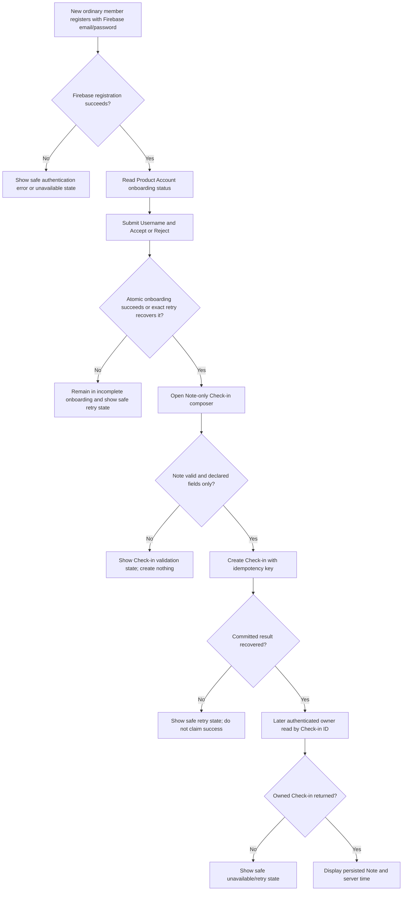
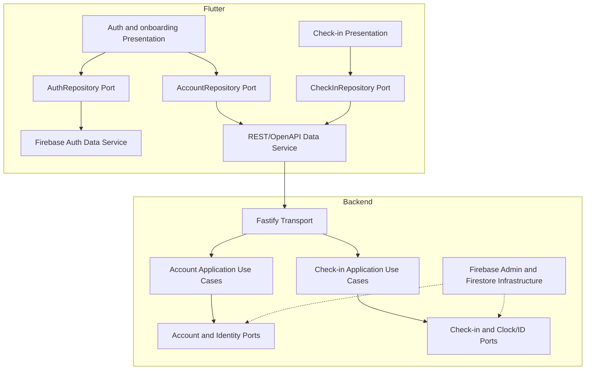

# RMVP-01A authenticated entry and first persisted Check-in — contract preview

- **Status:** R1 review preview retained for traceability; not approved as the final Q-33 contract; current review moved to R2
- **Preview ID:** RMVP-01A-CONTRACT-PREVIEW-0903-R1
- **R2 amendment direction:** [S-PM-0903-RMVP01A-R2DIR](../../decisions/2026-09-03-rmvp-01a-r2-amendment-direction.md)
- **Current review preview:** [RMVP-01A-CONTRACT-PREVIEW-0903-R2](2026-09-03-rmvp-01a-refinement-contract-r2-preview.md)
- **Approved product selection:** [S-PM-0903-RMVP01A-SEL](../../decisions/2026-09-03-rmvp-01a-product-selection.md)
- **Architecture authorities:** [S-PM-0901](../../decisions/2026-09-01-flutter-client-architecture.md), [S-PM-0901-BACKEND](../../decisions/2026-09-01-backend-architecture.md)
- **Release/platform authorities:** [S-PM-0901-SCOPE](../../decisions/2026-09-01-comp3851b-mvp-scope-priorities.md), [S-PM-0902-IOS01](../../decisions/2026-09-02-ios-product-delivery-deferral.md), [S-PM-0903-UAT02](../../decisions/2026-09-03-uat-r2-platform-amendment.md)
- **UAT anchors:** `CORE-01.A`, `CORE-02.A`, `CORE-05.A`, affected `X-01`

## 1. Approval boundary

This document is a human-reviewable contract proposal, not an approved requirement, Ready finding, estimate, assignment, implementation plan, or external-system change. Approval would settle only the exact behavior, physical contract, error semantics, logical persistence records, and test boundary stated here.

It intentionally excludes Mood, Weather, Activity, Approx Location, AI assistance, Check-in edit/delete, Calendar, Footprint, social exposure, Add Friend/Friend Request, profile detail collection, Interest selection, password recovery, email-verification workflow, offline success/synchronization, and iOS product implementation/UAT.

## 2. Domain language

| Term | Definition |
|---|---|
| Ordinary member | A non-Admin ENMORI Account authenticated through Firebase email/password. |
| Auth Principal | Backend-trusted identity derived only from a verified, non-expired, non-revoked, enabled Firebase ID token. |
| Product Account | The Backend-owned record that binds an Auth Principal to ENMORI Account state without exposing internal AccountId. |
| Initial Choice | The single onboarding decision whose `accept` branch records optional-processing consent and Public visibility, and whose `reject` branch records rejection and Private visibility. |
| Check-in | A server-owned record created for the authenticated ordinary member. In this slice it contains Note only plus authoritative identity and time. |
| Later read | A separate authenticated Backend request made after create success to retrieve the created Check-in by its opaque Check-in ID. |

## 3. BDD narrative and acceptance criteria

### Story — a new ordinary member records a first private or public Note Check-in

As a connected new ordinary community member,
I want to register, make either approved initial choice, and save a Note-only Check-in,
so I can enter ENMORI and receive independently verifiable proof that my first Check-in belongs to me and was persisted.

### AC-01 — Accept branch

```gherkin
Given a new ordinary member has a valid unregistered email, valid password, and available canonical Username
When the member completes Firebase email/password registration
And submits the Initial Choice "accept"
Then the Product Account records optional processing as accepted
And records profile visibility as Public
And marks onboarding complete
And permits entry to the ordinary-member flow
```

### AC-02 — Reject branch

```gherkin
Given a new ordinary member has a valid unregistered email, valid password, and available canonical Username
When the member completes Firebase email/password registration
And submits the Initial Choice "reject"
Then the Product Account records optional processing as rejected
And records profile visibility as Private
And marks onboarding complete
And permits entry to the ordinary-member flow
And no rejected optional processing is performed
```

### AC-03 — resumable incomplete onboarding

```gherkin
Given Firebase registration succeeded
And Product Account onboarding did not complete
When the authenticated member re-enters the app
Then the member is routed to incomplete onboarding
And is not represented as a completed Product Account
And may retry the same onboarding submission
```

### AC-04 — Note-only Check-in persistence

```gherkin
Given an authenticated ordinary member has completed Product Account onboarding
And the member provides a valid Note with no Mood, Weather, Activity, or Approx Location
When the member saves the Check-in
Then the Backend creates exactly one owner-authorized Check-in
And assigns an opaque Check-in ID and server-authoritative UTC time
And returns a successful saved outcome
```

### AC-05 — independent later read

```gherkin
Given AC-04 returned a Check-in ID
When the same authenticated owner later requests that Check-in ID
Then the Backend returns the same Note and server-authoritative creation time
And the Android surface displays a persisted result
```

### AC-06 — invalid or undeclared Check-in input

```gherkin
Given an authenticated onboarded ordinary member
When the member submits an empty/whitespace-only Note, an over-limit Note, or an undeclared field
Then no Check-in is created
And the client receives a stable safe validation result
```

### AC-07 — authentication and ownership failure

```gherkin
Given a missing, malformed, expired, revoked, disabled, or non-owner identity
When a protected onboarding, create, or read operation is attempted
Then the operation fails closed
And request input cannot select or replace the trusted owner
And no protected Check-in content is exposed
```

### AC-08 — connectivity/dependency failure and cancellation

```gherkin
Given an onboarding, create, or later-read request is pending
When connectivity or the affected Backend/Firebase/Firestore dependency fails
Then the app does not claim success or fabricate persisted data
And presents the approved generic unavailable/retry state

Given the member leaves the pending screen
When a late response arrives
Then the abandoned screen does not present that response
And any server commit that already completed remains authoritative and is reconciled by an explicit retry/read
```

## 4. Use cases

### UC-01 — Register Firebase identity

#### Data

- Email
- Password

#### Primary course

1. The member submits Email and Password through the Flutter Firebase Auth client.
2. Firebase Authentication validates the credentials and uniqueness.
3. Firebase Authentication creates the identity and authenticated session.
4. The app routes the authenticated member to Product Account onboarding.

#### Cancel course

1. Before Firebase accepts the submission, the app delivers neither success nor failure to an abandoned screen.
2. After Firebase creates the identity, cancellation does not fabricate Product Account completion; the next session resumes incomplete onboarding.

#### Error courses

- Invalid credentials: the app presents the safe Firebase-authentication validation state and creates no Product Account.
- Email already registered: the app presents a safe existing-account state and creates no second identity.
- Dependency unavailable: the app presents unavailable/retry and does not claim registration success.

### UC-02 — Complete Product Account onboarding

#### Data

- Auth Principal from verified Firebase ID token
- Canonical Username input
- Initial Choice: `accept` or `reject`
- Idempotency key

#### Primary course

1. The Backend verifies the Auth Principal, revocation, and enabled state.
2. The Backend validates and canonicalizes Username under Q18-B.
3. The Backend derives consent and visibility only from Initial Choice.
4. The Backend atomically reserves Username, binds the Auth Principal to an internal AccountId, and creates the Product Account.
5. The Backend returns the safe onboarding projection without AccountId or Firebase UID.

#### Alternative course — exact retry

1. The Backend finds a completed onboarding operation for the same Auth Principal and idempotency key.
2. The Backend returns the original safe projection without duplicating records.

#### Cancel course

1. The app delivers neither success nor failure to an abandoned screen.
2. A committed server result remains authoritative and is recovered by the next onboarding-status request or exact retry.

#### Error courses

- Invalid identity: fail closed with `AUTH_REQUIRED`.
- Disabled/revoked identity: fail closed with `AUTH_FORBIDDEN`.
- Invalid Username: create nothing and return `USERNAME_INVALID`.
- Unavailable Username: create nothing and return privacy-safe `USERNAME_UNAVAILABLE`.
- Conflicting completed onboarding: create nothing and return `ONBOARDING_CONFLICT`.
- Dependency unavailable: create nothing or preserve the prior atomic commit; return `SERVICE_UNAVAILABLE` when no recoverable committed result is available.

### UC-03 — Create Note-only Check-in

#### Data

- Auth Principal
- Note
- Idempotency key

#### Primary course

1. The Backend verifies the Auth Principal and completed Product Account.
2. The Backend validates the Note and rejects undeclared request fields.
3. The Backend creates one Check-in with internal owner AccountId, opaque Check-in ID, Note, and server-authoritative UTC time.
4. The Backend returns the owner-safe Check-in projection.

#### Alternative course — exact retry

1. The Backend finds the committed create result for the same owner and idempotency key.
2. The Backend returns the original Check-in projection without creating a duplicate.

#### Cancel course

1. The app delivers neither success nor failure to an abandoned screen.
2. A server commit that completed before cancellation remains authoritative and is reconciled through an exact retry or later read.

#### Error courses

- Invalid/absent identity: return `AUTH_REQUIRED` and create nothing.
- Disabled/revoked identity: return `AUTH_FORBIDDEN` and create nothing.
- Incomplete onboarding: return `ONBOARDING_REQUIRED` and create nothing.
- Invalid Note or undeclared field: return `CHECKIN_INVALID` and create nothing.
- Reused idempotency key with different input: return `IDEMPOTENCY_CONFLICT` and create nothing new.
- Dependency unavailable: return `SERVICE_UNAVAILABLE` without claiming success.

### UC-04 — Read owned Check-in

#### Data

- Auth Principal
- Opaque Check-in ID from the create response

#### Primary course

1. The Backend verifies the Auth Principal and completed Product Account.
2. The Backend loads the Check-in by opaque Check-in ID.
3. The Backend verifies that the Auth Principal maps to the Check-in owner.
4. The Backend returns the owner-safe Check-in projection.

#### Cancel course

1. The app delivers neither data nor error to an abandoned screen.

#### Error courses

- Invalid/absent identity: return `AUTH_REQUIRED`.
- Disabled/revoked identity: return `AUTH_FORBIDDEN`.
- Missing or non-owned Check-in: return the same privacy-safe `CHECKIN_UNAVAILABLE` result and expose no ownership distinction.
- Dependency unavailable: return `SERVICE_UNAVAILABLE`.

## 5. Proposed model specifications

### Product Account

| Property | Type |
|---|---|
| `accountId` | Opaque internal AccountId; never in public payloads |
| `username` | Canonical Username under Q18-B: 3–30 characters from lowercase `a–z`, digits `0–9`, and `_`; begins/ends alphanumeric; no consecutive `_` |
| `optionalProcessingConsent` | Enum: `accepted`, `rejected` |
| `profileVisibility` | Enum: `public`, `private` |
| `onboardingCompletedAt` | UTC ISO 8601 server timestamp |

### Auth Binding

| Property | Type |
|---|---|
| `firebaseUid` | Internal Firebase UID; never in public payloads |
| `accountId` | Opaque internal AccountId |

### Username Reservation

| Property | Type |
|---|---|
| `canonicalUsername` | Q18-B canonical Username |
| `accountId` | Opaque internal AccountId |

### Note-only Check-in

| Property | Type |
|---|---|
| `checkInId` | Opaque Check-in ID |
| `ownerAccountId` | Opaque internal AccountId; omitted from public payloads |
| `note` | String, normalized by trimming leading/trailing Unicode whitespace, then 1–500 Unicode grapheme clusters; internal whitespace/line breaks preserved |
| `createdAt` | UTC ISO 8601 server timestamp |

### Public App Failure

| Property | Type |
|---|---|
| `code` | Stable identifier from the proposed error catalogue |
| `message` | Safe non-sensitive user-facing message |
| `requestId` | Opaque correlation/request ID |

## 6. Proposed logical Firestore records

The names below are proposed physical schema and require approval. All writes occur through Backend Infrastructure; Flutter has no direct product-data access.

| Record path | Required fields | Purpose |
|---|---|---|
| `accounts/{accountId}` | `username`, `optionalProcessingConsent`, `profileVisibility`, `onboardingCompletedAt` | Product Account state |
| `auth_bindings/{firebaseUid}` | `accountId` | Internal verified-identity binding |
| `username_reservations/{canonicalUsername}` | `accountId` | Global immutable Username reservation |
| `check_ins/{checkInId}` | `ownerAccountId`, `note`, `createdAt` | Note-only Check-in persistence |
| `idempotency/{derivedId}` | internal AccountId/Auth Principal scope, operation, SHA-256 key digest, request fingerprint, committed response reference, server expiry metadata | Exact retry/deduplication for onboarding and Check-in creation without using the raw client key as a document path |

Onboarding atomically creates the Auth Binding, Username Reservation, and Product Account. Check-in creation atomically creates the Check-in and its committed idempotency result. Exact retention duration for idempotency records is proposed as 24 hours and requires approval.

## 7. Proposed REST/JSON payload contracts

All paths use the controlled HTTPS edge. Protected requests carry a Firebase ID token as Bearer authentication. Create commands require an `Idempotency-Key` containing 22–64 base64url characters; the raw key is never logged or used as a Firestore path. Client-selected AccountId/Firebase UID/owner/timestamp fields are rejected.

### Complete Product Account onboarding

```http
PUT /v1/me/onboarding
Authorization: Bearer <firebase-id-token>
Idempotency-Key: <opaque-client-generated-key>
Content-Type: application/json

{
  "username": "miku_01",
  "initialChoice": "accept"
}
```

```http
201 Created

{
  "account": {
    "username": "miku_01",
    "optionalProcessingConsent": "accepted",
    "profileVisibility": "public",
    "onboardingCompletedAt": "2026-09-03T03:15:00Z"
  }
}
```

An exact idempotent retry returns `200 OK` with the same projection. `initialChoice: "reject"` returns `optionalProcessingConsent: "rejected"` and `profileVisibility: "private"`.

### Read onboarding status

```http
GET /v1/me/onboarding
Authorization: Bearer <firebase-id-token>
```

```http
200 OK

{
  "status": "required"
}
```

Completed example:

```http
200 OK

{
  "status": "completed",
  "account": {
    "username": "miku_01",
    "optionalProcessingConsent": "rejected",
    "profileVisibility": "private",
    "onboardingCompletedAt": "2026-09-03T03:15:00Z"
  }
}
```

### Create Note-only Check-in

```http
POST /v1/check-ins
Authorization: Bearer <firebase-id-token>
Idempotency-Key: <opaque-client-generated-key>
Content-Type: application/json

{
  "note": "Finished the first ENMORI vertical slice refinement."
}
```

```http
201 Created

{
  "checkIn": {
    "checkInId": "chk_01J7Y8BHF13M9Q2K6P0A4R5T7V",
    "note": "Finished the first ENMORI vertical slice refinement.",
    "createdAt": "2026-09-03T03:20:00Z"
  }
}
```

### Read owned Check-in

```http
GET /v1/check-ins/{checkInId}
Authorization: Bearer <firebase-id-token>
```

```http
200 OK

{
  "checkIn": {
    "checkInId": "chk_01J7Y8BHF13M9Q2K6P0A4R5T7V",
    "note": "Finished the first ENMORI vertical slice refinement.",
    "createdAt": "2026-09-03T03:20:00Z"
  }
}
```

### Error envelope

```http
4xx or 503

{
  "error": {
    "code": "CHECKIN_INVALID",
    "message": "Check-in details are invalid.",
    "requestId": "req_01J7Y8D19K3M2P5V6T4N0C8Q7R"
  }
}
```

| Code | HTTP status | Applicable boundary |
|---|---:|---|
| `AUTH_REQUIRED` | 401 | Missing, malformed, or expired authentication |
| `AUTH_FORBIDDEN` | 403 | Revoked or disabled identity |
| `USERNAME_INVALID` | 400 | Q18-B validation failure |
| `USERNAME_UNAVAILABLE` | 409 | Reserved/unavailable Username without disclosing cause |
| `ONBOARDING_REQUIRED` | 409 | Product operation before completed onboarding |
| `ONBOARDING_CONFLICT` | 409 | Auth Principal already bound to different completed onboarding input |
| `CHECKIN_INVALID` | 400 | Invalid Note or undeclared create field |
| `CHECKIN_UNAVAILABLE` | 404 | Missing or non-owned Check-in, intentionally indistinguishable |
| `IDEMPOTENCY_CONFLICT` | 409 | Same key reused with different input |
| `SERVICE_UNAVAILABLE` | 503 | Affected controlled dependency unavailable |

## 8. Behavioral flow



## 9. Shared app-level dependency projection

This diagram applies the already approved architecture; it does not approve concrete class names or package versions.



Legend: `-->` is a strong dependency; `-.->` is Infrastructure conformance to an inner Port. The approved composition roots construct concrete dependencies. Inner Application/Domain layers never import Infrastructure.

## 10. Required tests and evidence

| Level | Required coverage |
|---|---|
| Flutter unit/widget | Accept and Reject state derivation; incomplete-onboarding routing; Note validation; pending/cancel/error/success rendering; no late result on abandoned screen |
| Flutter integration | Firebase Auth adapter against isolated emulator; onboarding status/retry; create then later-read flow through Repository/ViewModel/Router |
| Backend Domain/Application | Initial Choice invariant; Username canonicalization handoff; atomic onboarding intent; Note validation; ownership; idempotency exact retry/conflict; stable failures |
| Backend Transport | Bearer auth hook; strict schemas; undeclared-field rejection; every listed status/error mapping; response serialization |
| Infrastructure contract | Auth Binding/Product Account/Username Reservation atomicity; Check-in persistence; server time; owner read; Emulator Suite isolation |
| OpenAPI | Paths, schemas, examples, status codes, optionality, and implementation consistency |
| Android product evidence | Fresh install/build identity; both initial branches; Note-only create; later read; invalid Note; missing/expired/revoked/disabled identity variants as applicable to `CORE-01.A`, `CORE-02.A`, `CORE-05.A`, and `X-01` |

All fixtures use controlled non-real credentials/data. Evidence records build commit/artifact, Android device/OS/app ID, environment, timestamp/timezone, tester, steps, sanitized screenshots/logs, actual result, defect/retest, reviewer, and acceptor.

## 11. Q04/UI boundary

Affected surfaces are M02 Account registration, M06 Initial data-consent decision, M07 Initial privacy decision, M08 Home shell entry, M19 Check-in composer, and M20 Check-in saved outcome.

This preview proposes the following bounded production projection:

- M02 excludes the unapproved six-digit verification workflow, password recovery, profile details, and Interest onboarding; it includes Email, Password, canonical Username, submission, invalid/unavailable Username, authentication failure, pending, and incomplete-onboarding retry states.
- M06/M07 implement both approved Initial Choice outcomes and exact purpose/privacy semantics; prototype wording remains evidence only.
- M19 exposes Note only for this slice and no Mood/Weather/Activity/Approx Location controls as implemented functionality.
- M20 shows saved Note and server time only after create succeeds, then confirms persistence through the separate later read.

Q04 shared-pattern, accessibility, Android responsive/device, capture/provenance, and detailed visual acceptance remain required. Approval of this contract would not by itself make those Q04 evidence gates pass.

## 12. Traceability and proposed Ready effect

| Contract element | UAT/test anchor | Ready effect if approved |
|---|---|---|
| Registration + Accept | `CORE-01.A` | Resolves selected account-entry and Accept behavior |
| Registration + Reject | `CORE-02.A` | Resolves Reject continuation and privacy/consent behavior |
| Note-only create | `CORE-05.A` | Resolves selected first Check-in variant |
| Auth fail closed | affected `X-01` | Resolves slice-specific identity/error semantics only |
| Later owner read | RMVP-01A persistence proof | Resolves immediate-message-only evidence gap |
| Proposed API/schema/errors | Contract/OpenAPI tests | Would resolve the slice's physical-contract gate after approval |

Even if approved, RMVP-01A remains `Not Ready` until Q04 affected-surface acceptance/evidence, compatible dependency choices, accepted Points, task-hour estimates, PM-assigned owner and different reviewer, task/test allocation, controlled Backend/Firebase prerequisites, and Android device/execution commitment are all recorded.

## 13. Objective trade-offs requiring acknowledgement

- **Firebase registration and Product Account creation cannot be one Firestore transaction.** This preview therefore chooses recoverable incomplete onboarding instead of claiming cross-service atomicity or attempting an unapproved automatic Firebase-user deletion rollback.
- **Internal AccountId remains distinct from Firebase UID.** The Auth Binding adds one lookup/transaction dependency but preserves Q18's identity boundary and avoids silently declaring Firebase UID to be the canonical Product Account identity.
- **The paired Initial Choice is deliberately narrow.** It implements only the approved `accept → accepted/Public` and `reject → rejected/Private` combinations. It does not authorize independent consent/privacy combinations or Friends-only during onboarding.
- **The Note contract adds new physical limits.** The 500-grapheme maximum and normalization rule are proposed implementation-facing requirements; no earlier authority supplied these values.
- **A 24-hour idempotency window bounds operational storage but is not permanent duplicate prevention.** An exact retry inside the window recovers the committed result; a later deliberate submission requires a new key and is a new command.
- **Check-in social visibility semantics remain deferred.** RMVP-01A proves only an owner-authorized create/read path. It does not decide whether later social visibility is stored as a creation snapshot or evaluated from current settings.

## 14. Exact PM decisions requested

Approval is requested for this preview exactly as written, including:

1. the `PUT/GET /v1/me/onboarding` and `POST/GET /v1/check-ins` contract;
2. the four logical Firestore record groups plus 24-hour idempotency records;
3. atomic onboarding and exact-retry behavior;
4. Note normalization/validation by outer Unicode-whitespace trimming, preservation of internal whitespace/line breaks, and a resulting length of 1–500 Unicode grapheme clusters;
5. the stable error catalogue and privacy-safe unavailable semantics;
6. the explicit M02/M06/M07/M08/M19/M20 UI scope projection; and
7. the test/evidence boundary.

No estimate, assignment, Sprint selection, implementation, GitHub Projects write, Notion write, or Ready transition is included in this requested approval.
